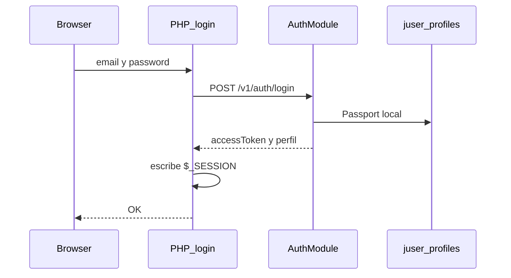

# Autenticación en Nest con Passport

Hoy no hay módulo de auth en booking. El login vive en PHP: [web/php/uslogin_verification.php](web/php/uslogin_verification.php) (anfitrión, exige fila en `jsites1`) y [web/php/soclogin_verification.php](web/php/soclogin_verification.php) (viajero, `role = customer`). Registro, “olvidé contraseña” y cambio de clave hacen SQL y SMTP en PHP. La API Nest solo conoce al usuario porque el proxy PHP manda `user_id` de la sesión detrás de `X-Internal-Key`.

La sesión PHP **se mantiene** con las mismas claves (`user_id`, `user_role`, `user_email`, `user_name`, y en anfitrión `client` + `name`). Lo que cambia es quién comprueba la contraseña, hashea, registra y emite el token.

## Módulo Nest `contexts/auth`

Dependencias nuevas: `@nestjs/passport`, `@nestjs/jwt`, `passport`, `passport-local`, `passport-jwt`, `bcrypt`.

Tabla de usuarios: la legacy `v4p_juser_profiles` (campos de entidad en snake_case). No se duplica el usuario.

Tabla nueva `auth_password_resets`: `id`, `user_id`, `token_hash`, `expires_at`, `used_at`. El enlace del correo lleva un token opaco; **no** la contraseña ni el hash (el flujo actual de `socmissing_sendMail.php` mete el hash en la URL).

Estrategias:

- **Local**: email + password. Acepta bcrypt `$2y$` (el de PHP) y, si el anfitrión aún tiene el cifrado legacy de `encrypt_decrypt`, lo verifica una vez y rehashea a bcrypt. Sin contraseña maestra.
- **JWT**: access corto en el body; refresh opaco en tabla `auth_refresh_tokens` (hash, `expires_at`, `revoked_at`).

Rutas bajo `/v1/auth`, todas con `InternalApiKeyGuard` (el navegador sigue hablando solo con PHP, igual que el panel del viajero). Añadirlas a la lista pública/interna que cubre `tests/unit/contexts/shared/guard-coverage.test.ts` si el test enumera controladores.

- `POST /login` `{ email, password, audience: "customer" | "host" }`
  - `customer`: el rol debe ser `customer`.
  - `host`: el rol debe ser `host` y debe existir alojamiento en `v4p_jsites1` por `email` o `email2`. La respuesta incluye `site_id` y `site_name` para que PHP rellene `$_SESSION['client']` y `$_SESSION['name']`.
- `POST /register` `{ email, name, password }` solo `customer`. Email único. Bienvenida vía [MailQueueService](booking/src/contexts/mail/mail.module.ts) (ya existe).
- `POST /forgot-password` `{ email }`: respuesta siempre genérica (no revela si el email existe). Encola el correo con enlace a la página de restablecer ya existente (`socchpwd` / `uschpwd`) pero con `?token=`.
- `POST /reset-password` `{ token, password }`: un solo uso, caduca.
- `POST /change-password` Bearer access `{ current_password, new_password }`.
- `POST /refresh` y `POST /logout` (revoca el refresh).
- `GET /me` Bearer: perfil sin password.

El access token se guarda en `$_SESSION['access_token']` para usarlo después. En esta entrega **no** se sustituye `InternalApiKeyGuard` en reservas, perros ni Stripe: esas rutas siguen igual para no romper el panel.

## Puente PHP (misma sesión)

Los formularios de [web/php/uslogin_body.php](web/php/uslogin_body.php), [web/php/soclogin_body.php](web/php/soclogin_body.php), registro club, missing y chpwd **no cambian de markup**. Cambia el PHP que hoy hace el `SELECT` de password:

- Login anfitrión y club: POST a Nest y, si `ok`, escriben la sesión actual y responden `OK` (el JS ya redirige).
- Registro viajero ([web/php/socregister_verification.php](web/php/socregister_verification.php)): deja la validación de campos/captcha en PHP y delega el alta a Nest.
- Recuperación: Nest genera el token; PHP solo muestra el formulario y reenvía `token` + password nueva.
- Cambio de clave en perfil (`usprofile_chpwd`, viajero): POST a `/change-password` con el access de la sesión.

El alta de **alojamiento** (wizard `usregister` / `jsites1`) no se reescribe. Si ese flujo inserta la fila de `juser_profiles`, el hash lo hace un endpoint `POST /v1/auth/register-host` para no dejar `password_hash` en PHP. La UI del wizard se queda.

## Fuera de esta entrega

- Quitar `$_SESSION` como fuente de identidad en menú y proxies.
- Proteger las rutas de negocio con el JWT en lugar de la API key interna.
- Captcha: sigue en PHP.

## Checklist de revisión

- Login club con usuario `customer` abre la cuenta y la sesión tiene `user_id` / `user_role` sin `client`.
- Login anfitrión exige alojamiento y rellena `client` y `name`.
- Un viajero no entra por el login de anfitrión y al revés.
- Registro club rechaza email duplicado y guarda bcrypt.
- “Olvidé contraseña” no dice si el email existe; el enlace caduca y no sirve dos veces.
- Cambio de clave en perfil pide la actual.
- Contraseña antigua `$2y$` sigue entrando y queda rehasheada.
- Panel de reservas, perros y menú siguen funcionando con la sesión.
