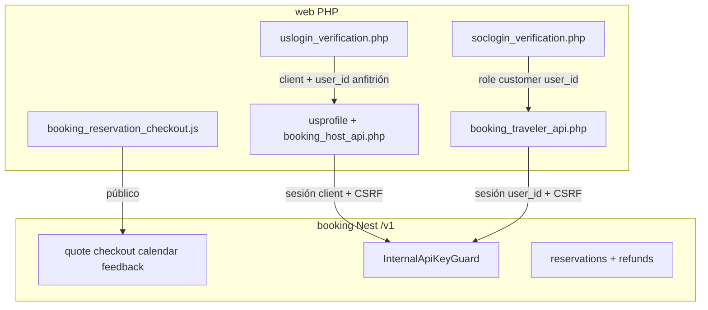

# Panel del viajero V1 — instrucciones para implementación

Documento de **análisis y especificación técnica**. No sustituye el PDF de producto; lo traduce a rutas, archivos y decisiones de código. **No implementa nada por sí mismo.**

Para pagos, cobro inmediato, reembolsos y webhooks, lee primero:

- [HANDOFF-siguiente-agente.md](../payments/HANDOFF-siguiente-agente.md) (flujos económicos ya hechos).
- [F0](../payments/F0-seguridad-y-bugs-criticos.md) / [F1](../payments/F1-modelo-economico.md) / [F2](../payments/F2-precio-completo.md).

Fuentes de producto (PDF en adjuntos del proyecto, no versionados aquí):

- **Panel del viajero V1** — navegación, pantallas, cancelación con preview, cambios, incidencias.
- **Implementación de políticas de cancelación** — tarifa + snapshot + penalizaciones (motor ya existe en código, sin cablear).
- **Manual Pagos / Reembolsos / Liquidaciones** — reglas que el panel **consume**, no duplica.

---

## 1. Objetivo de producto (resumen)

Una **única cuenta** (Club 4Patas + viajero) desde la que el usuario:

- Ve su próximo viaje y alertas.
- Lista reservas (próximas / pasadas / canceladas) con estados en lenguaje claro.
- Abre el **detalle** de cada reserva leyendo el **snapshot** congelado (perros, Dog Friendly, precio, política).
- Cancela con **preview económico** antes de confirmar.
- Gestiona **perros reutilizables** y **perfil** sin alterar reservas ya confirmadas.
- Solicita **cambios** e **incidencias** (la reserva original sigue vigente hasta aceptación explícita).
- Accede al Club (ventajas); **puntos y fidelización** quedan fuera de V1.

La interfaz no muestra enums de Stripe ni del backend cuando exista una etiqueta funcional.

---

## 2. Arquitectura actual (qué es qué)



### 2.1 Dos tipos de usuario en PHP (crítico)

| Rol            | Tabla                                    | Login                               | Sesión                                                             | Panel actual                                                                                 |
| -------------- | ---------------------------------------- | ----------------------------------- | ------------------------------------------------------------------ | -------------------------------------------------------------------------------------------- |
| Viajero / Club | `{db}_juser_profiles`, `role = customer` | `web/php/soclogin_verification.php` | `user_id`, `user_email`, `user_name`, `user_role`. **No** `client` | No hay área “mis reservas”. Solo checkout con `traveler_token` si está logueado al reservar. |
| Anfitrión      | Mismo perfil + fila en `{db}_jsites1`    | `web/php/uslogin_verification.php`  | `client` = site id, `user_id`, `name` del alojamiento              | `web/xx/usprofile.php` → `web/php/usprofile_body.php`                                        |

**Implicación:** el panel del viajero debe colgarse de **sesión `customer`** (`soclogin`), no de `usprofile`. Un anfitrión que también viaja puede tener dos flujos de login; el PDF pide **evolucionar** la cuenta Club para que sea también el espacio del viajero, sin obligar a crear otra cuenta.

Registro Club: `web/php/socregister_verification.php` inserta en `juser_profiles` con `role = customer`.

### 2.2 Qué NO reutilizar como panel del viajero

| Ruta / archivo                                  | Por qué no es el panel del viajero                                                                                               |
| ----------------------------------------------- | -------------------------------------------------------------------------------------------------------------------------------- |
| `web/php/usprofile_body.php`                    | Cuenta del **alojamiento**: Stripe Connect, habitaciones, reservas **del site** (`GET /v1/reservations/by-site/:site_id/range`). |
| `web/components/usprofile_reservations_tab.php` | Listado host + reembolso excepcional.                                                                                            |
| `GET /v1/reservations/:id?session_id=`          | Solo página de éxito post-Stripe; no es detalle de cuenta.                                                                       |

### 2.3 Qué ya existe para el viajero (backend + un proxy)

| Capacidad            | Ruta API                                                                   | Archivo principal                                     | Notas                                                                                 |
| -------------------- | -------------------------------------------------------------------------- | ----------------------------------------------------- | ------------------------------------------------------------------------------------- |
| Reservar y pagar     | `POST /v1/reservations/quote`, `POST /v1/reservations/checkout`            | `reservation.controller.ts`, `reservation.service.ts` | Graba `reservations.user_id` si `traveler_token` válido (`booking_checkout_lib.php`). |
| Cancelar (sin UI)    | `POST /v1/reservations/:id/cancel-traveler`                                | `reservation-refund.service.ts`                       | Interno.                                                                              |
| Proxy cancelación    | `POST web/php/booking_traveler_api.php?action=reservation_cancel_traveler` | Mismo archivo                                         | Body: `reservation_id`, `cancellation_reason`, `notes?`. Motivos: ver §5.             |
| Valorar estancia     | `GET/POST /v1/reservations/feedback/:token`                                | `reservation-feedback.service.ts`                     | Token por email; reutilizar en reservas pasadas del panel.                            |
| Snapshot en BD       | `reservation_snapshots`                                                    | `reservation-snapshot.entity.ts`                      | Payload con perros, dog policy, líneas, `refund_policy`.                              |
| Disputa fuerza mayor | `reservation_disputes`                                                     | Entidad en reservas                                   | Se abre al cancelar con `force_majeure`.                                              |

**No existe** hoy:

- `GET` de reservas por `user_id` del viajero.
- `GET` de detalle enriquecido (snapshot + payments + refunds) para el panel.
- `POST` preview de cancelación (solo ejecuta cancelación).
- Pantallas PHP/JS del área privada del viajero.
- CRUD de “mis perros” del viajero en BD legacy o booking.
- Entidades de solicitud de cambio, incidencia con adjuntos, propuesta de alternativa.

---

## 3. Inventario por bloque del plan (estado y dónde tocar)

Los cinco bloques del plan de producto se mapean así:

| ID plan             | Bloque                              | Estado        | Dependencias                                                               |
| ------------------- | ----------------------------------- | ------------- | -------------------------------------------------------------------------- |
| gap-list-detail     | Listado + detalle desde snapshot    | **Por hacer** | API `by-traveler`, proxy ampliado, páginas web nuevas                      |
| gap-cancel-preview  | Preview + motivos PDF               | **Parcial**   | API cancela; falta preview, motivos, adjuntos, cablear `quoteCancellation` |
| gap-dogs-profile    | Mis perros + perfil viajero         | **Por hacer** | Tabla o módulo nuevo; no confundir con snapshot                            |
| gap-home            | Inicio + alertas                    | **Por hacer** | Depende de listado + datos de alerta                                       |
| gap-change-incident | Cambios + incidencias + alternativa | **Por hacer** | Modelo de datos + colas V4P (mínimo viable)                                |

---

## 4. Bloque 1 — Listado y detalle (gap-list-detail)

### 4.1 Qué debe hacer el producto

- Pestañas: **Próximas**, **Pasadas**, **Canceladas**.
- Tarjeta: alojamiento, fechas, viajeros/perros, **estado funcional**, total, enlace al detalle.
- Detalle: todo lo del PDF §5–6 (estancia, perros declarados, Dog Friendly del snapshot, desglose, política/deadline, pagos/reembolsos como historial).

### 4.2 API a crear (booking)

Sugerencia de rutas (todas con `InternalApiKeyGuard`; el viajero nunca llama la API directamente):

| Método | Ruta propuesta                          | Query / body                                            | Responsabilidad                                                                                                                                                                                       |
| ------ | --------------------------------------- | ------------------------------------------------------- | ----------------------------------------------------------------------------------------------------------------------------------------------------------------------------------------------------- |
| `GET`  | `/v1/reservations/by-traveler/:user_id` | `tab=upcoming\|past\|cancelled` (o filtrar en servidor) | Listar reservas donde `reservations.user_id = :user_id`. Incluir código `#RES-{id}`, fechas, `status`, `payment_status`, `total_cents`, nombre de site/room (join legacy MySQL o campos en snapshot). |
| `GET`  | `/v1/reservations/:id/traveler-detail`  | `user_id` en query o header interno                     | Verificar propiedad. Cargar reserva + último `reservation_snapshots` + `reservation_price_lines` + últimos `payments` / `refunds`. Devolver DTO estable para la UI (no el payload crudo sin mapear).  |

**Dónde colgar el código:**

- Controlador: ampliar `src/contexts/reservations/api/reservation.controller.ts` o crear `traveler-reservations.controller.ts` bajo el mismo módulo.
- Servicio nuevo recomendado: `src/contexts/reservations/services/traveler-reservation-panel.service.ts` (lectura sola, sin transacciones de dinero).
- Mapeo de estado funcional: función pura `mapTravelerFacingStatus(reservation, refunds?, disputes?)` en `src/contexts/reservations/utils/traveler-panel-status.util.ts`.

### 4.3 Tabla de mapeo de estados (UI)

La UI **no** muestra `pending_charge`, `processing`, `partially_refunded`, etc.

| Condición backend (orden de evaluación sugerido)                                                                | Etiqueta viajero                                  |
| --------------------------------------------------------------------------------------------------------------- | ------------------------------------------------- |
| `status = cancelled`                                                                                            | Cancelada                                         |
| Disputa/incidencia abierta relevante (`reservation_disputes.status = open` o refund `pending` por fuerza mayor) | Incidencia en revisión                            |
| `status = finalized`                                                                                            | Estancia finalizada                               |
| `status = pending` y `payment_status = pending`                                                                 | Pago pendiente                                    |
| `status = confirmed` y `payment_status = paid`                                                                  | Confirmada                                        |
| Otros                                                                                                           | Definir fallback conservador (“En proceso”) y log |

Textos en `jvariables` (página nueva, p. ej. `cuenta_viajero`).

### 4.4 Lectura del snapshot (campos útiles)

Archivo de tipos: `src/contexts/payments/domain/reservation-snapshot.ts`.

| Sección UI              | Campos del payload                                                                  |
| ----------------------- | ----------------------------------------------------------------------------------- |
| Perros declarados       | `SnapshotDog[]` en extensión F2 (`name`, `weight_kg`, `is_ppp`, `size`)             |
| Dog Friendly contratado | `dog_policy`, `compatibility`                                                       |
| Desglose                | `price_lines`, `total_cents`, `totals`                                              |
| Política cancelación    | `refund_policy` (`refund_deadline`, `generated_text`, `cancellation` cuando exista) |
| Fianza informativa      | `deposit` en extensión                                                              |

**Regla:** si el viajero editó su perro después, el detalle sigue mostrando el snapshot, no el perfil actual.

Datos de alojamiento (nombre, foto, dirección): hoy en MySQL `{db}_jsites1` / `{db}_jsites2`. El servicio puede leer por `reservation.site_id` con el mismo patrón que `ReservationService.getSiteById`.

### 4.5 Web PHP / JS a crear

Patrón existente (anfitrión): `xx/*.php` wrapper + `php/*_body.php` + componente + JS + proxy.

Propuesta de estructura (nombres orientativos):

| Pieza                  | Ruta sugerida                                                                                                    |
| ---------------------- | ---------------------------------------------------------------------------------------------------------------- |
| Wrapper cuenta viajero | `web/xx/mi-cuenta.php` o reutilizar entrada Club con `selTab`                                                    |
| Cuerpo + variables     | `web/php/mi_cuenta_body.php` (carga `jvariables` pagina `cuenta_viajero`)                                        |
| Pestaña reservas       | `web/components/traveler_reservations_tab.php`                                                                   |
| JS listado/detalle     | `web/js/traveler_reservations.js`                                                                                |
| Proxy                  | **Ampliar** `web/php/booking_traveler_api.php` con acciones whitelist: `reservations_list`, `reservation_detail` |

Guard del proxy (igual que cancelación):

- `$_SESSION['user_id']` ≥ 1.
- `user_role === 'customer'` (o permitir también host que actúe como viajero si producto lo confirma).
- CSRF en POST.
- `user_id` en la llamada a la API = sesión, nunca del body del navegador.

### 4.6 Criterios de aceptación (tests manuales)

- Usuario Club logueado ve solo sus reservas (`user_id` coincidente).
- Reserva hecha como invitado (`user_id = 0`) no aparece (hasta que exista vinculación por email; fuera de V1 salvo que producto lo pida).
- Detalle coincide con snapshot v1 aunque el alojamiento cambie precios o política después.
- Estados mostrados son los de la tabla §4.3.

---

## 5. Bloque 2 — Cancelación con preview y motivos (gap-cancel-preview)

### 5.1 Qué hay hoy

| Pieza                 | Ubicación                                                                                                                                                              |
| --------------------- | ---------------------------------------------------------------------------------------------------------------------------------------------------------------------- |
| Ejecutar cancelación  | `POST /v1/reservations/:id/cancel-traveler` → `ReservationRefundService.cancelByTraveler`                                                                              |
| Motivos API (6)       | `TRAVELER_CANCELLATION_REASONS` en `refund-policy.util.ts` + lista en `booking_traveler_api.php`                                                                       |
| Plazo / importe       | Dentro de plazo → reembolso **total** (`resolveTravelerRefundAmountCents` = importe cobrado entero). Fuera → sin refund. `force_majeure` → refund `pending` + dispute. |
| Política estructurada | `quoteCancellation` en `cancellation-policy.ts` **no se usa** en cancelación. Snapshot guarda regla legacy 24 h (`buildRefundRule`).                                   |

### 5.2 Qué pide el PDF del panel (motivos)

Catálogo V1 (códigos sugeridos para API; etiquetas en `jvariables`):

| Código sugerido            | Descripción producto                                |
| -------------------------- | --------------------------------------------------- |
| `change_of_plans`          | Cambio de planes / ya no puedo viajar               |
| `illness_person`           | Salud viajero o persona vinculada (ya existe)       |
| `illness_pet`              | Enfermedad grave mascota (ya existe)                |
| `death_person`             | Fallecimiento persona vinculada (ya existe)         |
| `death_pet`                | Fallecimiento mascota (ya existe)                   |
| `transport`                | Problema transporte / desplazamiento                |
| `financial`                | Problema económico                                  |
| `other_accommodation`      | Otro alojamiento                                    |
| `booking_error`            | Error al reservar                                   |
| `accommodation_conditions` | Condiciones del alojamiento                         |
| `dog_conditions`           | Condiciones para viajar con perro                   |
| `force_majeure`            | Circunstancia excepcional (ya existe; revisión V4P) |
| `other`                    | Otro + texto obligatorio                            |

**Regla de negocio:** el motivo **no** cambia la política económica salvo `force_majeure` (flujo revisión). Enfermedad/fallecimiento **no** abren reembolso automático fuera de plazo.

Archivos a actualizar al ampliar motivos:

- `src/contexts/reservations/utils/refund-policy.util.ts`
- `src/contexts/reservations/dto/traveler-cancel-reservation.dto.ts`
- `web/php/booking_traveler_api.php` (`$allowed`)
- Textos modal cancelación en el nuevo JS del panel

### 5.3 Preview económico (por hacer)

Nueva ruta interna, **sin efectos**:

`POST /v1/reservations/:id/cancel-traveler/preview`

Body: `{ user_id, cancellation_reason }` (mismo ownership que cancel).

Respuesta sugerida:

```json
{
  "can_cancel": true,
  "paid_cents": 60000,
  "penalty_cents": 30000,
  "refund_cents": 30000,
  "within_free_period": false,
  "deadline_iso": "2026-08-13T21:59:59.000Z",
  "policy_text": "...",
  "releases_inventory": true,
  "requires_review": false
}
```

**Implementación:**

1. Cargar snapshot y reserva.
2. Si `refund_policy.cancellation` existe → `quoteCancellation` (`cancellation-policy.ts`) con `first_night_cents` derivado de líneas de alojamiento.
3. Si no existe → mantener comportamiento legacy (ventana 24 h, reembolso 0 o total).
4. `force_majeure`: `requires_review: true`, `refund_cents` informativo (monto solicitable tras revisión), **no** llamar Stripe en preview.

Proxy: `booking_traveler_api.php?action=reservation_cancel_preview`.

Flujo UI: preview → modal con penalización / reembolso → confirm → `reservation_cancel_traveler`.

### 5.4 Circunstancia excepcional y adjuntos

Hoy: `notes` (string) en dispute JSON. Falta:

- Subida de archivos (PHP → almacenamiento seguro, referencias en dispute o tabla `reservation_incident_attachments`).
- Estado visible “Pendiente de revisión V4P”.
- No mostrar “reembolso completado” hasta webhook (ya corregido en flujo de pagos; el panel solo refleja `refunds.status`).

### 5.5 Fuera de alcance en este bloque

- Aviso “Actualizar método de pago” → cobro diferido (`charge_mode = flexible`), no implementado.

---

## 6. Bloque 3 — Mis perros y perfil (gap-dogs-profile)

### 6.1 Qué hay hoy

- En reserva: perros van en quote/checkout y quedan en **snapshot** (`SnapshotDog`).
- En checkout: el viajero escribe perros en el wizard; **no** hay biblioteca persistente por usuario en booking.
- Perfil Club: `juser_profiles` (`id`, `email`, `name`, `password`, `role`, `stripe_account_id`). No hay columnas de teléfono/foto en el esquema estándar revisado; comprobar migraciones locales antes de asumir.

### 6.2 Qué hay que diseñar

**Mis perros** (reutilizables en futuras reservas):

| Campo                              | Obligatorio |
| ---------------------------------- | ----------- |
| `user_id` (FK `juser_profiles.id`) | sí          |
| `name`                             | sí          |
| `weight_kg`                        | sí          |
| `is_ppp`                           | sí          |
| `photo_path` o referencia media    | no          |

Opciones de implementación:

- **A)** Tabla nueva en MySQL legacy `{db}_jtraveler_dogs` (PHP CRUD + API interna opcional).
- **B)** Módulo Nest + tabla en BD booking (más coherente si el checkout ya llama a la API).

Al reservar: el checkout **copia** los perros elegidos al snapshot; un `UPDATE` del perro guardado no toca `reservation_snapshots`.

**Mi perfil:**

- Nombre, apellidos (si se añaden columnas o tabla extendida), email (lectura), teléfono, cambio de contraseña (`usprofile_chpwd.php` como referencia de patrón, pero para `customer`).
- Avatar opcional (misma idea que PDF §2.1).
- Sin datos de tarjeta.

Páginas: pestaña en la misma cuenta viajero; variables `cuenta_viajero` / `cuenta_perros`.

---

## 7. Bloque 4 — Inicio y alertas (gap-home)

### 7.1 Contenido

- Saludo con nombre (`$_SESSION['user_name']` tras soclogin).
- Avatares de perros guardados (bloque 3).
- **Próximo viaje:** primera reserva de la pestaña “próximas” por `checkin` ascendente.
- **Alertas** (solo si aplican):
  - Fin próximo del periodo de cancelación gratuita → calcular desde `refund_policy.refund_deadline` del snapshot.
  - Incidencia en revisión → dispute/refund pending.
  - Propuesta de cambio pendiente → cuando exista entidad de cambio (bloque 5).
  - Deuda viajero → **no implementar** (manual de pagos, cobro diferido).

### 7.2 Implementación

- Reutilizar `GET by-traveler` con filtro `upcoming` y límite 1 para la tarjeta principal.
- Endpoint opcional `GET /v1/traveler/:user_id/dashboard` que agregue alertas en un solo round-trip (recomendado para rendimiento).

---

## 8. Bloque 5 — Cambios, incidencias y alternativa (gap-change-incident)

### 8.1 Solicitud de cambio (“¿Necesitas cambiar tu reserva?”)

Producto:

- Tipos: añadir noches, cambiar fechas, viajeros, perros, extras, otro.
- Texto opcional.
- **La reserva original no cambia** hasta propuesta aceptada y, si hay cargo, pago OK.
- Propuesta: antes/después, precio, diferencia; botones Aceptar / Mantener actual.
- Aceptar con pago extra → mismo patrón que checkout (nuevo cobro o sesión Stripe).
- Aceptar con devolución → flujo refund existente.
- Confirmación → **nuevo** `reservation_snapshots.version + 1`, enlace al anterior; nunca `UPDATE` del payload viejo.

**Modelo de datos sugerido (booking):**

- `reservation_change_requests` (id, reservation_id, user_id, type, message, status, created_at).
- `reservation_change_proposals` (id, request_id, payload json antes/después, amount_delta_cents, status, expires_at).
- Estados: `received`, `in_review`, `proposal_sent`, `accepted`, `rejected`, `cancelled`.

API interna + acciones en `booking_traveler_api.php`. Cola V4P/host: fuera del panel viajero en V1 mínimo (solo crear solicitud y mostrar estado).

### 8.2 “Tengo un problema con mi reserva”

Tipos PDF: antes de llegar, durante estancia, perro, condiciones no respetadas, cobro, reembolso, otro.

- Reutilizar o extender `reservation_disputes` / nueva tabla `reservation_incidents` con `type`, `description`, adjuntos.
- Estados UI: Recibida → En revisión → Necesitamos información → Resuelta.
- Impacto económico: transición `payout_status` a `blocked` en **esa** reserva (`ReservationEconomicsService.transitionPayout`). Ver HANDOFF pagos.

### 8.3 Imposibilidad de alojar / alternativa

- No es cancelación del anfitrión en panel.
- Entidad `reservation_alternatives` (reservation_id, propuesta json, status `pending_traveler|accepted|rejected`).
- Viajero acepta solo si compatible con perros del snapshot.

---

## 9. Navegación V1 (mapa de pantallas)

```
MI CUENTA V4P (sesión customer)
├── Inicio          → §7
├── Mis reservas    → §4 (tabs + detalle)
├── Mis perros      → §6
├── Club 4Patas     → enlazar xx/club4patas.php o contenido existente; sin puntos
├── Mi perfil       → §6
└── Ayuda           → página ayuda general; incidencias de reserva desde detalle §8
```

Cabecera: avatar + nombre; menú desplegable (PDF §2.1). Implementar en `mi_cuenta_body.php` + CSS alineado al sitio.

**Club / puntos:** dejar navegación y copy placeholder; **no** implementar generación ni canje de puntos (PDF §15 pendiente de modelo).

---

## 10. Valoraciones y documentos

| Funcionalidad                        | Enfoque                                                                                                                                         |
| ------------------------------------ | ----------------------------------------------------------------------------------------------------------------------------------------------- |
| Valorar estancia                     | En reserva pasada, botón que abre URL con token de feedback o embebe flujo existente (`/v1/reservations/feedback/:token`).                      |
| Documentos en reserva                | No sección global. En detalle: enlace “Condiciones aceptadas” = snapshot + política; historial pagos/refunds = datos de `payments` / `refunds`. |
| Email “Antes de viajar con tu perro” | Tarea aparte; no bloquea el panel.                                                                                                              |

---

## 11. Orden de implementación recomendado

1. **API** `by-traveler` + `traveler-detail` + util de estados.
2. **Proxy** `booking_traveler_api.php` (list + detail).
3. **UI** Mis reservas (listado + detalle solo lectura).
4. **Preview cancelación** + ampliación motivos + modal en detalle.
5. **Perros + perfil** (persistencia + pestañas).
6. **Inicio** (dashboard).
7. **Cambios e incidencias** (modelo + flujos mínimos).

No empezar por incidencias si no existe el detalle de reserva: la UX del PDF asume que todo cuelga del detalle.

---

## 12. Checklist para quien implemente

- [ ] Leído [HANDOFF-siguiente-agente.md](../payments/HANDOFF-siguiente-agente.md) (no duplicar lógica de cobro/refund).
- [ ] Migración `1791100000000-charge-mode-immediate` aplicada en el entorno.
- [ ] Panel usa **soclogin** (`customer`), no `usprofile`.
- [ ] Nuevos textos en `jvariables`, no hardcode en PHP/JS.
- [ ] Detalle lee **snapshot**, no política viva del site.
- [ ] Estados UI según §4.3.
- [ ] Cancelación: preview antes de `cancel-traveler`.
- [ ] `quoteCancellation` cableado cuando exista `refund_policy.cancellation`.
- [ ] Tests unitarios booking: añadir tests para mapeo de estados y preview (vitest).
- [ ] No implementar cobro diferido, deuda, liquidación semanal ni puntos Club en esta entrega.

---

## 13. Referencia rápida de archivos existentes

| Tema                           | Archivo                                                                    |
| ------------------------------ | -------------------------------------------------------------------------- |
| Handoff pagos completo         | `booking/docs/payments/HANDOFF-siguiente-agente.md`                        |
| Cancelación viajero (ejecutar) | `booking/src/contexts/reservations/services/reservation-refund.service.ts` |
| Política cancelación (motor)   | `booking/src/contexts/payments/domain/cancellation-policy.ts`              |
| Snapshot                       | `booking/src/contexts/payments/domain/reservation-snapshot.ts`             |
| Proxy viajero actual           | `web/php/booking_traveler_api.php`                                         |
| Login viajero Club             | `web/php/soclogin_verification.php`                                        |
| Login anfitrión                | `web/php/uslogin_verification.php`                                         |
| Checkout                       | `web/js/booking_reservation_checkout.js`                                   |
| Token viajero en checkout      | `web/inc/booking_checkout_lib.php`                                         |

---

_Última actualización: documento alineado al plan “Qué falta del panel del viajero (V1)” y al estado del código en booking/web. Si implementas una pieza, añade una subsección “Implementado en” con la ruta real y fecha, sin borrar las instrucciones originales._
