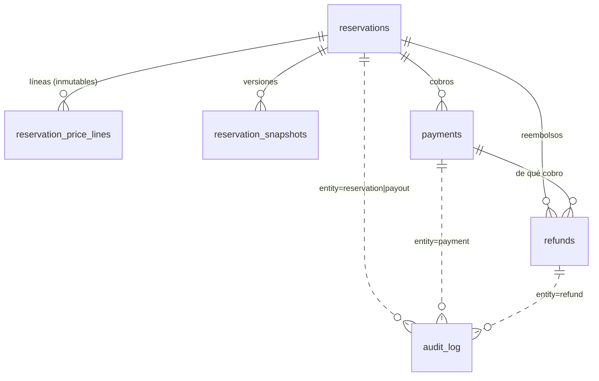
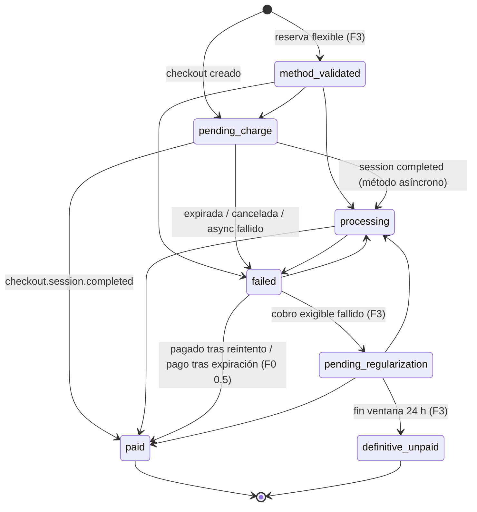
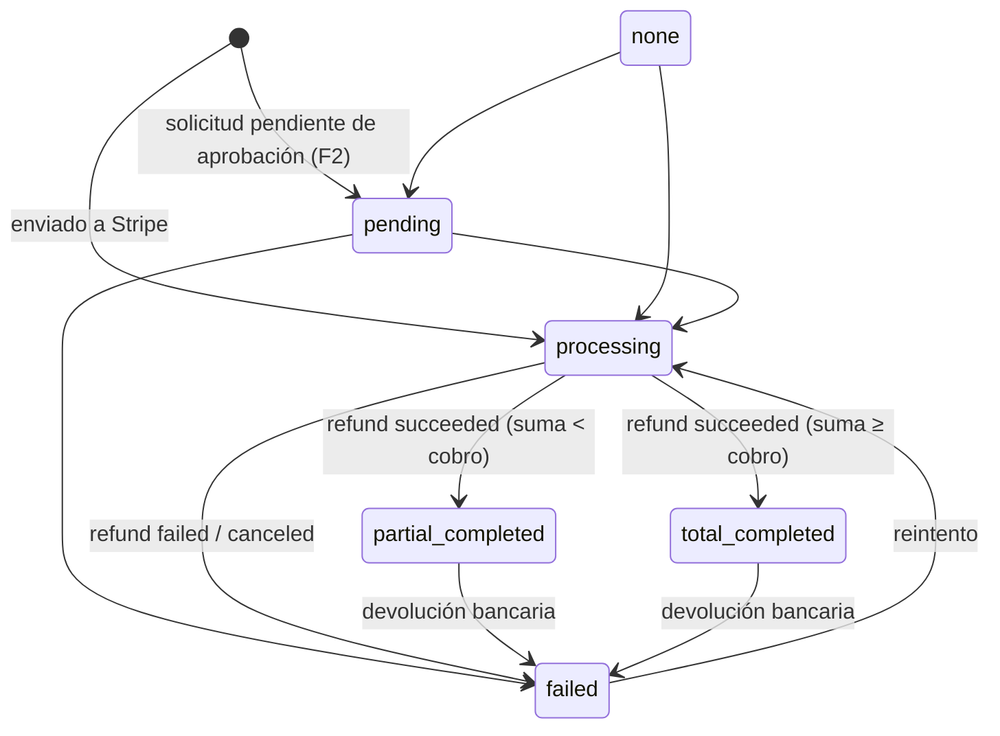
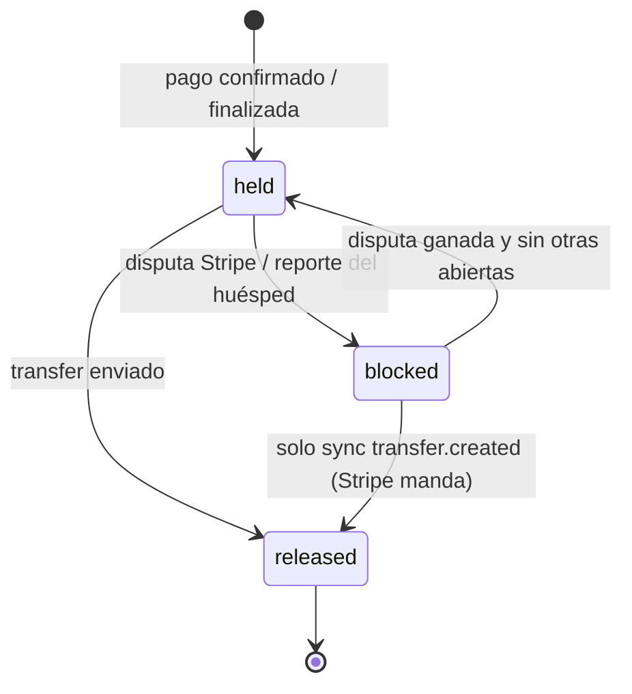

# F1 — Modelo económico base

Fase 1 del plan de pagos V4P. Construye sobre F0 (`F0-seguridad-y-bugs-criticos.md`).
Objetivo: que cada reserva tenga un **registro económico propio, inmutable y auditable**
(líneas de precio, snapshot versionado, pagos, reembolsos, auditoría) en vez de inferir
el estado del dinero a partir de columnas sueltas de `reservations`.

> **Antes de desplegar:** ejecutar las migraciones F0 **y** F1
> (`1791000000000-payments-f0-hardening`, `1791000000100-payments-f1-economic-model`).
> Sin la F1 la API falla con `Unknown column 'ReservationEntity.commission_rate'`
> en cualquier consulta de reservas.

Referencias del manual del cliente (V4P_Pagos_Reembolsos_Liquidaciones_30sep): A2 (comisión 12 %),
A3/A4/A11 (base comisionable vs. penalizable), A10 (snapshot), B1–B5 (principios, entidades,
estados), B14 (auditoría), B18 (testing).

---

## 1. Qué cambia

| Antes (F0)                                                                       | Ahora (F1)                                                                                                                                                                                             |
| -------------------------------------------------------------------------------- | ------------------------------------------------------------------------------------------------------------------------------------------------------------------------------------------------------ |
| Importes en `decimal(10,2)` y cálculos con `float` (`Math.round(x*100)`).        | Toda tabla nueva guarda **céntimos enteros** (`INT`). Utilidades `money.util.ts` con redondeo _half-up_. Las columnas decimales legacy se mantienen (PHP las lee).                                     |
| Comisión = `COMMISSION_PERCENTAGE` del `.env` **en el momento del transfer**.    | Comisión **congelada en la reserva** al crearla (`commission_rate`, `commission_cents`), leída de `platform_settings.commission_rate` (0.12, A2). El env queda solo como _fallback_ para filas legacy. |
| El precio era `subtotal`/`total` + `board_snapshot`.                             | `reservation_price_lines` inmutables con flags comisionable/penalizable/opcional.                                                                                                                      |
| Sin snapshot contractual.                                                        | `reservation_snapshots` versionado (v1 al crear), nunca se sobrescribe (A10).                                                                                                                          |
| Estado de pago = `reservations.payment_status` (4 valores).                      | Tabla `payments` con máquina de estados B3. `payment_status` legacy se sigue escribiendo para PHP.                                                                                                     |
| Reembolso = `stripe_refund_id` + `payment_status`. Se daba por hecho al crearlo. | Tabla `refunds` con máquina B4. **La finalización la decide Stripe** (`refund.created/updated/failed`). Un refund fallido revierte las columnas legacy.                                                |
| `reservation_events` (log libre).                                                | Además `audit_log` _append-only_ con actor, antes/después y metadatos (B14). `reservation_events` se mantiene.                                                                                         |

---

## 2. Modelo de datos

Todas las tablas nuevas sin prefijo (como `reservations`), InnoDB, `utf8mb4`.
FKs a `reservations(id)` con `ON DELETE RESTRICT` (no hay borrado de reservas desde F0).



### `platform_settings`

| Columna       | Tipo                              | Nota            |
| ------------- | --------------------------------- | --------------- |
| `key` (PK)    | varchar(64)                       |                 |
| `value`       | varchar(255)                      | se tipa al leer |
| `value_type`  | enum(`string`,`number`,`integer`) |                 |
| `description` | varchar(255) NULL                 |                 |
| `updated_at`  | datetime(6)                       |                 |

### `reservation_price_lines` (inmutable: solo INSERT)

| Columna                                              | Tipo                                                                                                                            | Nota                                          |
| ---------------------------------------------------- | ------------------------------------------------------------------------------------------------------------------------------- | --------------------------------------------- |
| `id`                                                 | int PK                                                                                                                          |                                               |
| `reservation_id`                                     | int FK                                                                                                                          |                                               |
| `type`                                               | enum(`accommodation`,`board`,`dog_supplement`,`dog_service`,`additional_service`,`extra`,`tourist_tax`,`discount`,`adjustment`) |                                               |
| `description`                                        | varchar(255)                                                                                                                    |                                               |
| `quantity`                                           | decimal(10,3)                                                                                                                   | admite decimales                              |
| `unit_amount_cents`, `amount_cents`                  | int                                                                                                                             | negativos **solo** en `discount`/`adjustment` |
| `currency`                                           | char(3)                                                                                                                         | `eur`                                         |
| `is_optional`, `is_commissionable`, `is_penalizable` | bool                                                                                                                            | A3/A4                                         |
| `metadata`                                           | json NULL                                                                                                                       |                                               |
| `created_by_type`                                    | enum actor                                                                                                                      | `system/traveler/host/admin/stripe`           |
| `created_by_id`                                      | varchar(64) NULL                                                                                                                |                                               |
| `created_at`                                         | datetime(6)                                                                                                                     |                                               |

Una corrección = **nueva línea** `adjustment`/`discount`, nunca UPDATE.

### `reservation_snapshots` (append-only)

`id`, `reservation_id` FK, `version` int (**único con reservation_id**), `reason` varchar(64)
(`checkout`, `manual_create`, `legacy_backfill`), `payload` json, `created_at`.

Payload v1 (`schema: 1`): `stay` (site, fechas, noches, huéspedes, mascotas), `room` (id, nombre,
máximos, precio/noche en céntimos), `board`, `currency`, `total_cents`, `price_lines`, `totals`
(total, base comisionable, base penalizable, opcional), `commission` (rate, cents, base),
`refund_policy` (regla vigente: reembolso total del anfitrión hasta 24 h antes del check-in UTC,
`refund_deadline`, `deadline_local_time`, `timezone`), `timezone`, `source`.

### `payments`

| Columna                                                                      | Tipo                    | Nota                                                                                     |
| ---------------------------------------------------------------------------- | ----------------------- | ---------------------------------------------------------------------------------------- |
| `id`                                                                         | int PK                  |                                                                                          |
| `reservation_id`                                                             | int FK                  |                                                                                          |
| `type`                                                                       | enum(`charge`)          |                                                                                          |
| `status`                                                                     | enum B3                 | ver §3                                                                                   |
| `amount_cents`, `currency`                                                   | int, char(3)            |                                                                                          |
| `stripe_checkout_session_id`, `stripe_payment_intent_id`, `stripe_charge_id` | varchar(255) NULL       | indexados (session, PI)                                                                  |
| `idempotency_key`                                                            | varchar(255) **UNIQUE** | `payment:checkout:{id}`, `payment:manual:{id}`, `payment:pi:{pi}`, `payment:legacy:{id}` |
| `failure_code`, `failure_message`                                            | varchar(128), text      |                                                                                          |
| `attempts`                                                                   | int                     | sesiones de checkout abiertas                                                            |
| `paid_at`, `created_at`, `updated_at`                                        | datetime                |                                                                                          |

### `refunds`

| Columna                                         | Tipo                                    | Nota                                                                                                                                           |
| ----------------------------------------------- | --------------------------------------- | ---------------------------------------------------------------------------------------------------------------------------------------------- |
| `id`                                            | int PK                                  |                                                                                                                                                |
| `reservation_id`                                | int FK                                  |                                                                                                                                                |
| `payment_id`                                    | int FK NULL                             |                                                                                                                                                |
| `status`                                        | enum B4                                 | ver §3                                                                                                                                         |
| `amount_cents`, `currency`                      | int, char(3)                            |                                                                                                                                                |
| `reason`                                        | varchar(128)                            | `host_cancelled`, `duplicate_payment`, `amount_mismatch`, `payment_after_expiry_dates_unavailable`, `manual_refund`, `external_stripe_refund`… |
| `requested_by_type/_id`, `approved_by_type/_id` | enum actor, varchar(64)                 |                                                                                                                                                |
| `responsible`                                   | enum(`host`,`platform`,`traveler`) NULL | cancelación del anfitrión → `host`; auto-reembolsos → `platform`                                                                               |
| `stripe_refund_id`                              | varchar(255) **UNIQUE**                 |                                                                                                                                                |
| `idempotency_key`                               | varchar(255) **UNIQUE**                 | la misma key que se manda a Stripe: `refund:{reservationId}:{n}`; externos `refund:stripe:{re_id}`; backfill `refund:legacy:{id}`              |
| `failure_reason`, `completed_at`, timestamps    |                                         |                                                                                                                                                |

### `audit_log` (append-only)

`id` bigint, `entity` (`reservation`,`payment`,`refund`,`payout`,`price_line`,`snapshot`,…),
`entity_id`, `action` (p. ej. `payment.status_changed`, `payment.transition_rejected`,
`refund.created`, `payout.release_failed`, `reservation.cancelled`), `actor_type`
(`system`,`traveler`,`host`,`admin`,`stripe`), `actor_id` (id de usuario, `site:{id}`, id de
evento Stripe, nombre de cron), `before`, `after`, `metadata` (json), `created_at`.
Índices `(entity, entity_id)` y `created_at`. El servicio **no tiene** update/delete.

### `reservations` (columnas nuevas, congeladas al crear)

| Columna            | Tipo              | Nota                                    |
| ------------------ | ----------------- | --------------------------------------- |
| `commission_rate`  | decimal(5,4) NULL | 0.1200                                  |
| `commission_cents` | int NULL          | F1: `round_half_up(rate × total_cents)` |
| `total_cents`      | int NULL          | espejo en céntimos de `total`           |
| `currency`         | char(3) NULL      |                                         |
| `snapshot_version` | int NULL          | última versión de snapshot              |
| `timezone`         | varchar(64) NULL  | `platform_settings.default_timezone`    |

> Ojo: `reservations.commission` (decimal, legacy) es un **recargo al viajero** que hoy siempre
> es 0 y forma parte del importe cobrado. `commission_*` es la **comisión V4P** que se retiene
> del payout del anfitrión. No se tocó la columna legacy para no cambiar el importe cobrado.

---

## 3. Máquinas de estado

Funciones puras en `src/contexts/payments/domain/*-state-machine.ts`. Mismo estado = _no-op_
idempotente (reintentos de webhook). Transición inválida:

- comandos (anfitrión/admin/cron): **error** (`InvalidTransitionError`) + `audit_log` `*.transition_rejected`
  escrito fuera de la transacción (sobrevive al rollback);
- eventos de Stripe fuera de orden: se **audita y se ignora** (no se devuelve 500, si no Stripe
  reintentaría 3 días).

### Pago (B3)



"Pagado tras reintento" queda como historial (`metadata.paid_after_failure` en audit), sin estado propio.
`paid` es final: los reembolsos viven en `refunds` (B1: estados independientes).

### Reembolso (B4)



`none` es el agregado de la reserva sin reembolsos (`aggregateRefundStatus`). Un `failed` nunca
pasa a completado sin volver a `processing` (B4/B18: "refund fallido → nunca marcar completado").

### Payout (subconjunto B5 en uso hoy, columna legacy `payout_status`)



Mapeo B5: `held` → `not_available`/`available` (según fin de la ventana de feedback),
`blocked` → `blocked_incident`, `released` → `settled`. `liquidationStateMachine` (B5 completo)
y `deriveLiquidationStatus()` quedan listos para F4 (liquidación semanal).

---

## 4. Flujos

### Checkout (`POST /v1/reservations/checkout`) — contrato público sin cambios

1. `quoteReservation` (igual que antes).
2. Fuera de la transacción: `resolveFrozenTerms()` (settings cacheados) + datos de la habitación.
3. **Una transacción** (la de F0 con `SELECT … FOR UPDATE` de noches):
   insert de la reserva **con** `commission_rate/commission_cents/total_cents/currency/timezone` →
   bloqueo de noches → `reservation_price_lines` (alojamiento: `quantity = noches`,
   `unit = precio/noche`; régimen: `amount = board_amount`; ambos comisionables y penalizables;
   si float y céntimos discrepan, una línea `adjustment` de redondeo garantiza
   `SUM(líneas) = importe cobrado`) → `payments` `pending_charge` → snapshot v1 → `audit_log`.
   Si algo falla, rollback de todo (nunca hay reserva sin registro económico).
4. Sesión de Stripe creada → `payments.stripe_checkout_session_id`, `attempts++` (misma tx que
   `reservations.stripe_checkout_session_id`).

`POST /v1/reservations` (interno, manual): mismo registro con una línea de alojamiento por el
`subtotal` (+ ajuste si `commission` legacy ≠ 0) y snapshot `manual_create`.

### Webhooks (transacción de F0, fila de reserva bloqueada)

| Evento                                                                                           | Efecto F1                                                                                                                                                                                                                                                                                                                   |
| ------------------------------------------------------------------------------------------------ | --------------------------------------------------------------------------------------------------------------------------------------------------------------------------------------------------------------------------------------------------------------------------------------------------------------------------- |
| `checkout.session.completed` (paid) / `async_payment_succeeded`                                  | `activateFromPayment` → `payments` → `paid` (vía máquina), audit `reservation.status_changed`, `payout` `∅→held`. Replay del mismo PI = no-op.                                                                                                                                                                              |
| `checkout.session.completed` (unpaid, método asíncrono)                                          | `payments` → `processing`                                                                                                                                                                                                                                                                                                   |
| `checkout.session.expired` / `async_payment_failed` / cron de expiración / fallo al crear sesión | `payments` → `failed` (`failure_code` = motivo). Nunca degrada un `paid`.                                                                                                                                                                                                                                                   |
| Pago no honrable (F0 0.5: fechas ocupadas, importe distinto, pago duplicado)                     | `payments` → `paid` (el dinero se capturó; duplicado = **fila nueva** `payment:pi:{pi}`) + `refunds` `processing` (`responsible=platform`)                                                                                                                                                                                  |
| `refund.created` / `refund.updated` / `refund.failed` (**nuevos**)                               | `syncRefundFromStripe`: `succeeded` → `partial/total_completed` (`completed_at`), `failed/canceled` → `failed` (+ revierte `amount_refunded`/`payment_status` legacy, evento `refund_failed`, log de error), `pending` → `processing`. Reembolsos hechos en el Dashboard → fila nueva `refund:stripe:{re_id}`. Idempotente. |
| `charge.refunded`                                                                                | Igual que F0 para las columnas legacy; además guarda `payments.stripe_charge_id` y, si el payload trae `refunds.data`, sincroniza esos refunds.                                                                                                                                                                             |
| `charge.dispute.created/closed`, `transfer.created`                                              | Cambios de `payout_status` pasan por la máquina de payout + audit.                                                                                                                                                                                                                                                          |

**Carrera refund.\* vs. transacción que crea el refund:** el handler bloquea primero la reserva
(`metadata.reservation_id` o PI) → espera al commit de la cancelación → encuentra la fila.
Si la cancelación hizo rollback tras crear el refund en Stripe, el webhook crea la fila
`refund:stripe:{id}` y el reintento de la cancelación la reutiliza (búsqueda por key **o** por
`stripe_refund_id`): nunca hay dos filas para el mismo refund.

### Cancelación del anfitrión con reembolso

`refundInTransaction` (key `refund:{id}:{n}` de F0) crea la fila `refunds` en `processing`
con `requested_by = approved_by = host (site:{id})`, `responsible = host`. Las columnas legacy
(`payment_status=refunded`, `amount_refunded`) se siguen escribiendo de forma optimista para PHP
y se revierten si llega `refund.failed`.

### Payout

`releaseHostPayout` calcula la comisión con `computePlatformFee`:

- sin reembolsos → `commission_cents` congelado;
- con reembolso parcial → `commission_rate` congelado × importe retenido (A4/A11: V4P solo cobra
  sobre lo que queda);
- fila legacy sin `commission_rate` → `COMMISSION_PERCENTAGE` (comportamiento anterior).

El importe de comisión viaja a Stripe en `transfer.metadata.platform_fee_cents`. Un release
fallido deja `audit_log` `payout.release_failed` (fuera de la transacción).

---

## 5. Configuración

### `platform_settings` (sembradas por la migración, `INSERT IGNORE`)

| Clave                            | Default         | Uso                                   |
| -------------------------------- | --------------- | ------------------------------------- |
| `commission_rate`                | `0.12`          | A2. Se congela en cada reserva nueva. |
| `deadline_local_time`            | `18:00`         | A6 (F2/F3). Ya va en el snapshot.     |
| `default_timezone`               | `Europe/Madrid` | `reservations.timezone`.              |
| `available_after_checkout_hours` | `24`            | A19 (F4).                             |
| `regularization_window_hours`    | `24`            | A7 (F3).                              |
| `payout_failure_days`            | `7`             | A22 (F4).                             |

`PlatformSettingsService` cachea en memoria (`PLATFORM_SETTINGS_CACHE_TTL_MS`); valores inválidos
→ default + warning; BD caída → último valor cacheado o defaults de código (nunca rompe el checkout).
Cambiar un valor: `UPDATE platform_settings SET value='0.15' WHERE \`key\`='commission_rate';`
(efectivo tras el TTL; solo afecta a reservas **nuevas**).

### Variables de entorno

| Variable                         | Default | Cambio                                                                                  |
| -------------------------------- | ------- | --------------------------------------------------------------------------------------- |
| `PLATFORM_SETTINGS_CACHE_TTL_MS` | `60000` | **Nueva** (opcional).                                                                   |
| `COMMISSION_PERCENTAGE`          | `0.1`   | Ya existía. Ahora solo _fallback_ legacy y tasa del backfill. Añadida a `.env.example`. |

---

## 6. Migración `1791000000100-payments-f1-economic-model`

Escrita a mano, `down` completo:

1. `CREATE TABLE IF NOT EXISTS` de las 6 tablas + semilla de `platform_settings`.
2. `ALTER TABLE reservations ADD COLUMN IF NOT EXISTS …` (6 columnas).
3. **Backfill idempotente** (lotes de 500, solo `snapshot_version IS NULL`), usando la función pura
   `planLegacyBackfill`:
   - 1 línea `accommodation` por el total histórico (`total`, o `subtotal + commission`),
     comisionable y penalizable (el desglose histórico no es fiable);
   - `payments` (key `payment:legacy:{id}`): `paid` si `payment_status ∈ {paid, refunded,
partially_refunded}`; `failed` si cancelada sin pagar (`failure_code = legacy:{cancel_reason}`);
     `pending_charge` en otro caso; sin pago para orígenes externos o importe 0;
   - `refunds` (key `refund:legacy:{id}`) si `refunded`/`partially_refunded`
     (`total_completed`/`partial_completed`, importe = `amount_refunded` o total);
   - snapshot v1 `legacy_backfill`; `commission_rate = COMMISSION_PERCENTAGE` del env en ese momento,
     `commission_cents = round(rate × total)`, `timezone = Europe/Madrid`, `currency = CURRENCY`;
   - `audit_log` `reservation.legacy_backfill` (solo si insertó el snapshot).
     Cada INSERT va protegido (`INSERT IGNORE` sobre claves únicas o `NOT EXISTS`) y el UPDATE usa
     `COALESCE`: re-ejecutar no duplica nada.

```bash
npm run migration:run      # aplica F0 (si falta) y F1
npm run migration:revert   # revierte solo F1
```

---

## 7. Cómo probar

### Automático

```bash
npx vitest run --config vitest.config.unit.ts
```

Nuevos (`tests/unit/contexts/payments/`):

- `money.util.test.ts`: half-up, parseo sin artefactos float (`1.005 → 101`), % en céntimos.
- `state-machines.test.ts`: transiciones válidas/ inválidas B3/B4/payout/B5, mapeo de estados
  Stripe, agregado de reembolsos, comisión en el transfer.
- `legacy-backfill.test.ts`: mapeo puro del backfill (pagada, pendiente, expirada, reembolsada
  total/parcial, manual sin `total`, origen externo, determinismo) + parseo de settings.
- `economic-flows.test.ts` (servicios reales sobre BD en memoria con rollback):
  checkout crea líneas/pago/snapshot/comisión congelada y hace rollback conjunto; webhook pagado
  idempotente; expirada → `failed` → pago tardío → `paid` con historial; evento tardío no degrada;
  cancelación con refund → `refund.updated` → `total_completed` (idempotente) → `charge.refunded`
  coherente; `refund.failed` revierte legacy y un `succeeded` tardío no lo completa; refund del
  Dashboard; snapshots versionados y reintento ante escritor concurrente.

### Manual (Stripe test)

1. Migraciones aplicadas. En el endpoint del webhook de Stripe añadir **`refund.created`,
   `refund.updated`, `refund.failed`**. Local: `stripe listen --forward-to localhost:3000/v1/webhook`
   (reenvía todos los eventos).
2. Reservar y pagar con `4242…`:
   ```sql
   SELECT id, commission_rate, commission_cents, total_cents, snapshot_version, timezone FROM reservations ORDER BY id DESC LIMIT 1;
   SELECT type, quantity, unit_amount_cents, amount_cents, is_commissionable, is_penalizable FROM reservation_price_lines WHERE reservation_id = ?;
   SELECT status, amount_cents, stripe_payment_intent_id, attempts FROM payments WHERE reservation_id = ?;  -- paid
   SELECT version, reason FROM reservation_snapshots WHERE reservation_id = ?;                              -- 1, checkout
   SELECT action, actor_type, actor_id, `before`, `after` FROM audit_log WHERE entity_id = ? ORDER BY id;
   ```
3. `stripe events resend evt_…` del `checkout.session.completed` → sin nuevas filas en `payments`
   ni nuevo `payment.status_changed`.
4. Cancelar con reembolso desde el panel → `refunds.status = processing` → tras `refund.updated`
   `total_completed` + `completed_at`.
5. Refund fallido: pagar con la tarjeta de test `4000 0000 0000 5126` (el refund empieza como
   `succeeded` y Stripe lo pasa a `failed` poco después) y cancelar con reembolso →
   `refunds.status = failed`, `reservations.payment_status` vuelve a `paid`, evento `refund_failed`.
   `stripe trigger refund.failed` crea un refund ajeno a cualquier reserva: se ignora con warning.
6. Liberar payout → `transfer.metadata.platform_fee_cents` = `commission_cents`.

---

## 8. Rollback

1. `npm run migration:revert` (solo `PaymentsF1EconomicModel1791000000100`): borra las 6 tablas
   y las 6 columnas de `reservations`. **Se pierde** el historial F1 (líneas, snapshots, pagos,
   reembolsos, auditoría) generado desde el despliegue; exportarlo antes si importa.
2. Revertir el código de booking a F0 a la vez (el código F1 lee las columnas nuevas).
3. Las columnas legacy (`payment_status`, `amount_refunded`, `stripe_refund_id`, `payout_status`)
   se siguieron escribiendo durante F1, así que F0/PHP siguen funcionando con los datos actuales.
4. Comisión: tras revertir, los transfers vuelven a usar `COMMISSION_PERCENTAGE`.

---

## 9. Riesgos / pendiente para F2+

- **Cambio de comisión:** reservas nuevas usan 12 % (`platform_settings`) en lugar del
  `COMMISSION_PERCENTAGE` actual del `.env` (default 10 %). Es la decisión A2; revisar el valor real
  del `.env` de producción y avisar a anfitriones si cambia.
- `commission_cents` se calcula sobre el **total** (alojamiento + régimen). F2: base comisionable
  (excluir tasa turística/no comisionables) y penalizable (A4/A11), penalizaciones por cancelación
  del viajero, extras opcionales con reembolso íntegro.
- Columnas legacy de reembolso se escriben de forma optimista al crear el refund (PHP las lee);
  la verdad está en `refunds` y se corrigen con `refund.failed`. Falta notificación (email) de
  refund fallido a admin (F2, A23).
- Si `refund.*` no se activa en el Dashboard de Stripe, las filas de `refunds` se quedan en
  `processing` (las columnas legacy siguen correctas por `charge.refunded`).
- `audit_log` crece sin límite (append-only por diseño); planificar retención/archivado.
- Sin endpoints de lectura todavía (panel del viajero/anfitrión/backoffice B9–B12): F2/F4.
- `extras_snapshot` sigue vacío en checkout (no hay extras vendibles aún); cuando se vendan, deben
  entrar como líneas `extra`/`dog_service` con sus flags.
- Liquidación semanal (B5 completo, `payout_failure_days`, `available_after_checkout_hours`): F4.
- Reserva flexible / `method_validated` / regularización 12 h (`regularization_window_hours`): F3.
